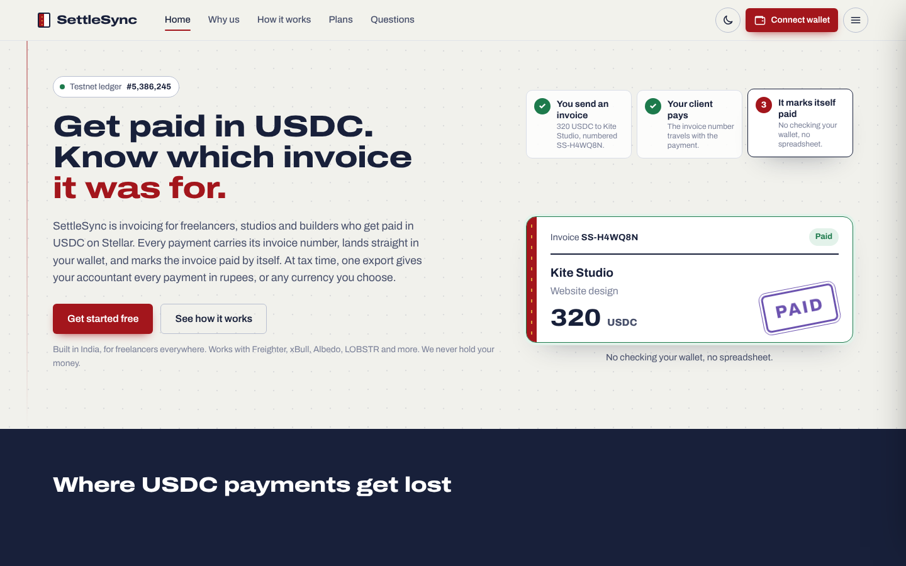
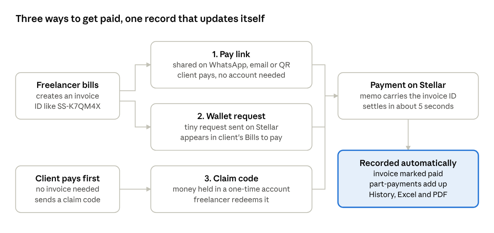
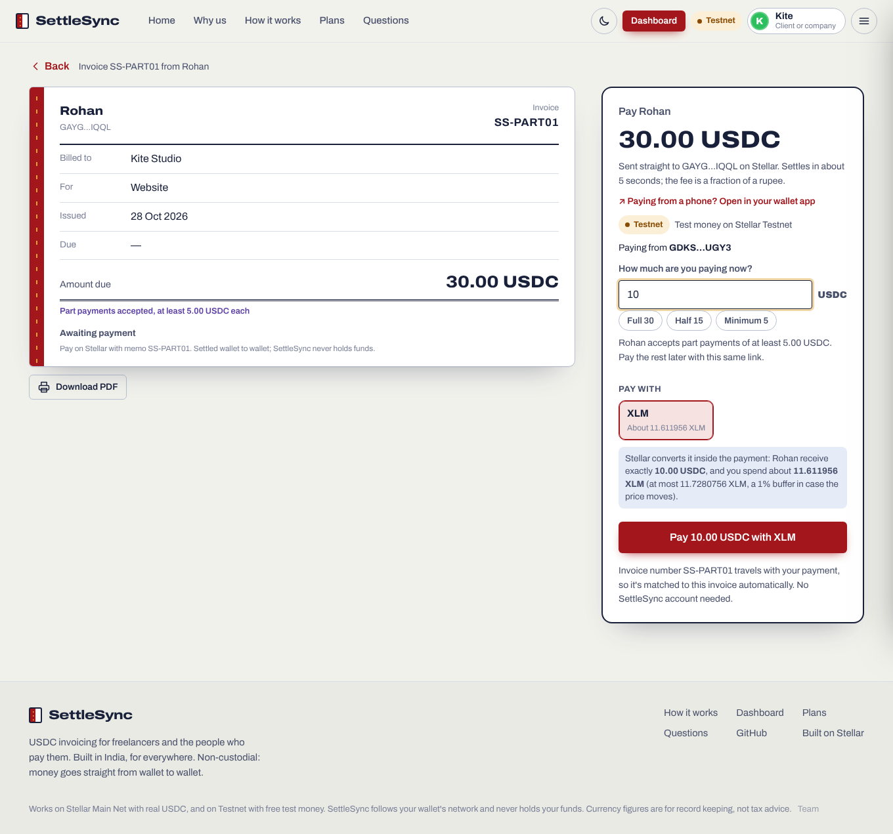
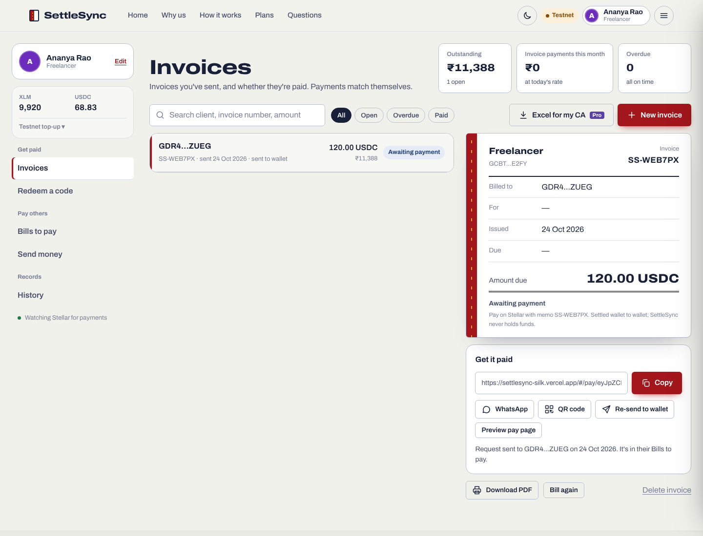
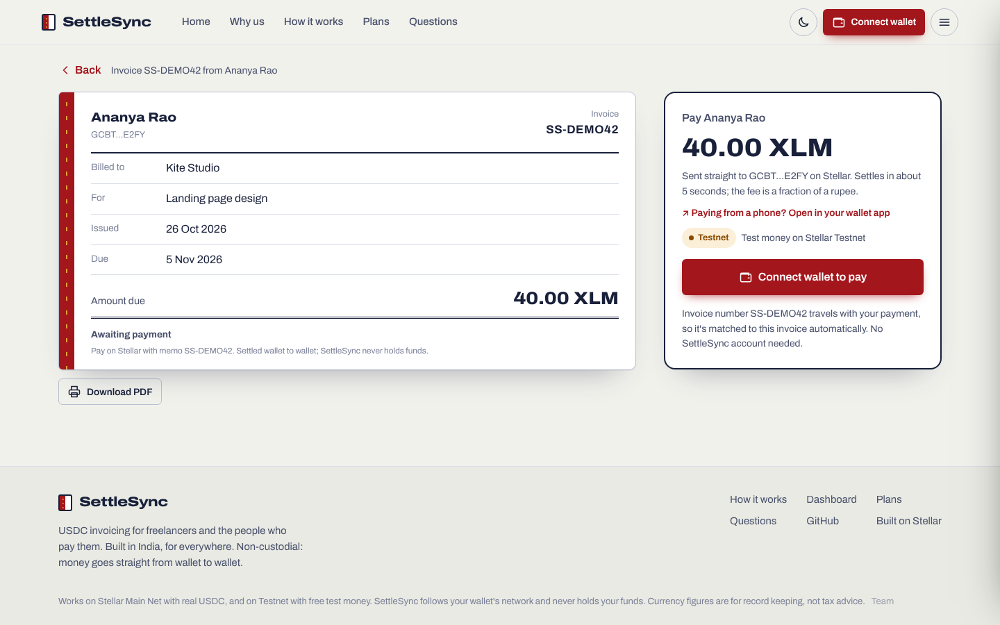
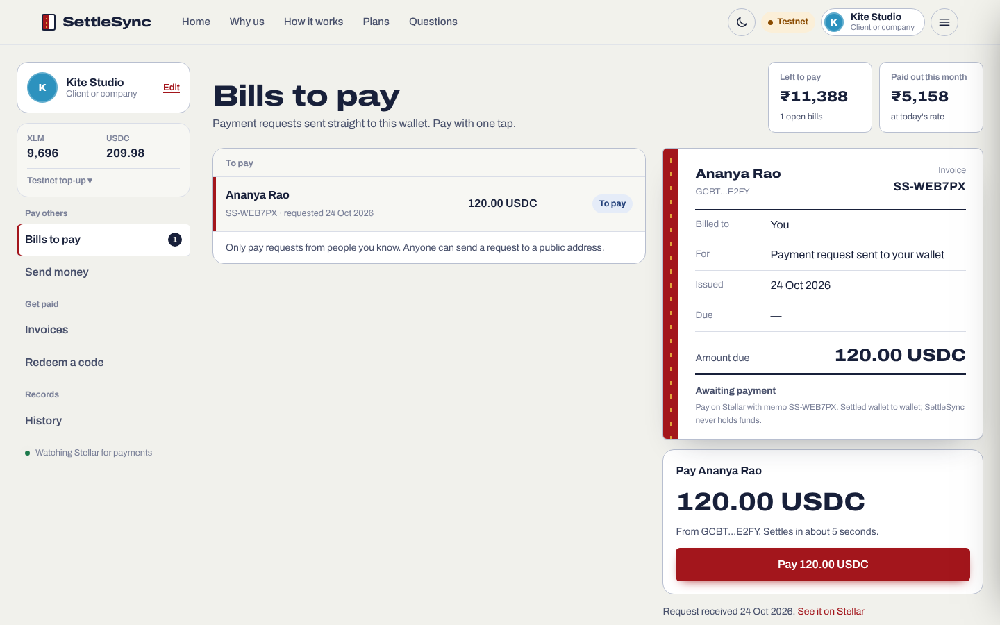
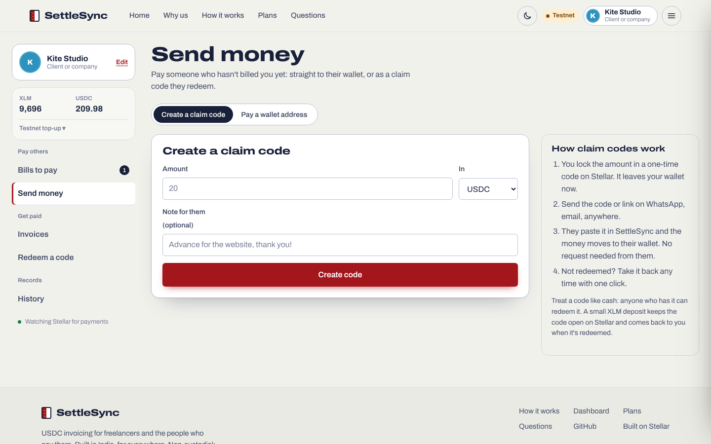
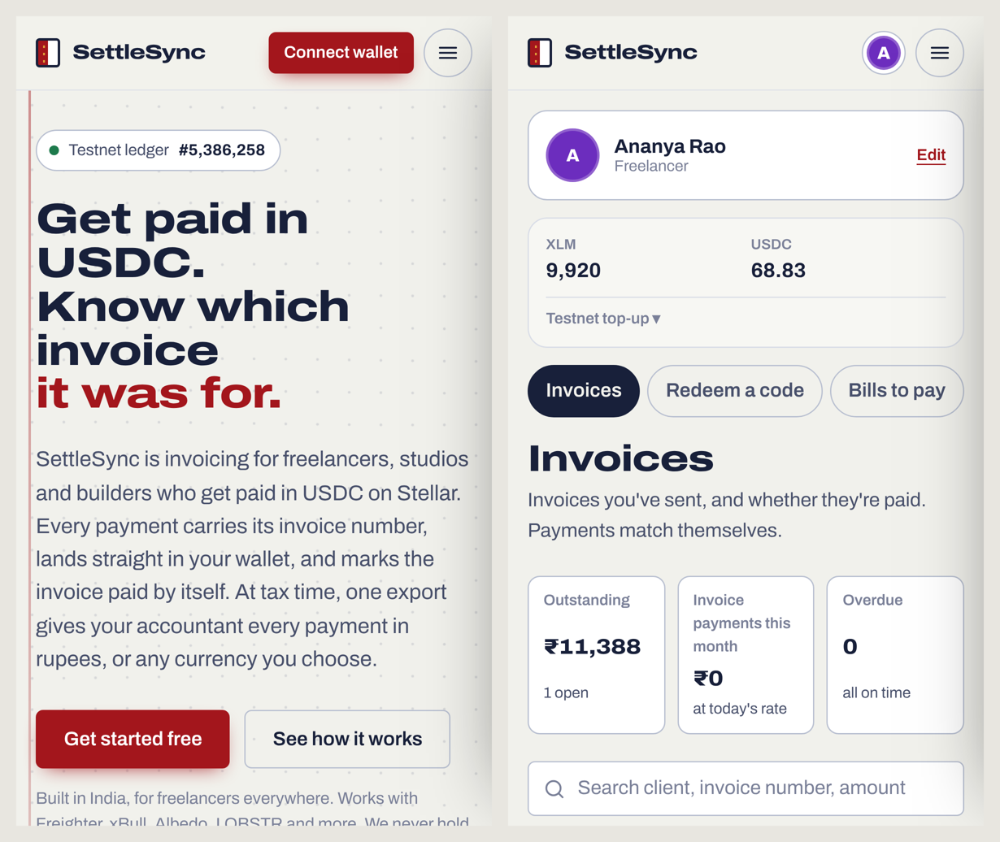

# SettleSync

**USDC invoicing for freelancers and the people who pay them, on Stellar.** Built in India, for everywhere.

Every payment carries its invoice number in the Stellar memo, so SettleSync knows which invoice it paid, marks it paid by itself, and exports a ledger for your accountant with the local-currency value on the day each payment arrived.

**Live app:** [settlesync-silk.vercel.app](https://settlesync-silk.vercel.app) · **Tester guide (PDF):** [docs/SettleSync-Tester-Guide.pdf](docs/SettleSync-Tester-Guide.pdf) · **Built by:** Rohan M D



**Status:** pilot. Works on **Stellar Main Net** (real USDC and XLM) and **Testnet** (free test money). SettleSync follows the connected wallet's network automatically.

## The problem

Developers, designers and contributors are increasingly paid in USDC by DAOs, grant programs and overseas clients. The payment lands in their wallet with nothing tying it to the work it paid for. Part-payments and late payments are tracked in spreadsheets, and at tax time the freelancer rebuilds a year of payments, with local-currency values, from a block explorer. Bank wires and PayPal take days and 3 to 5% plus FX; marketplaces take 10 to 20%.

## How it works



1. **Create an invoice:** client, amount (USDC or XLM), due date. SettleSync assigns an ID like `SS-K7QM4X`.
2. **Get it to the client**, three ways:
   - **Pay link:** share on WhatsApp, email or as a QR code. The client opens it, connects any Stellar wallet and pays in one click. No account needed.
   - **Wallet request:** enter the client's Stellar address. SettleSync sends the request on Stellar itself (a 0.0000001 XLM payment with memo `R:<invoiceId>:<amount>:<asset>`). It appears in the client's **Bills to pay** on any device.
   - **Claim code (client pays first):** the client locks the amount in a fresh one-time Stellar account, created and funded in one transaction co-signed by the payer's wallet and the one-time key. The code is that key: the recipient redeems it, SettleSync pays them, removes the trustline and data entries, and merges the account back to the payer so the XLM deposit returns. Unredeemed codes can be taken back.
3. **Part payments, if you allow them:** turn on *Allow part payments* when creating the invoice, optionally with a minimum per payment. The client chooses how much to pay each time (an advance now, the rest on delivery) from the same link or Bills to pay. The last part may be smaller than the minimum, so an invoice can always be finished.
4. **Pay in any currency:** the client can pay with any asset in their wallet that Stellar can convert, for example XLM for a USDC invoice. SettleSync uses a **path payment (strict receive)**: Stellar's built-in exchange converts it inside the same transaction, the freelancer receives exactly the invoiced amount, and the client sees the price first and never spends more than 1% above it.
5. **It marks itself paid:** the invoice ID is the payment's text memo. SettleSync watches incoming payments (including path payments) on Horizon and matches by memo and asset. Parts add up until the invoice is fully paid.
6. **Export for your accountant:** a formatted Excel workbook with every payment, the local-currency rate on the receipt day, totals, filters and a link to each transaction as proof. Plus a branded one-page PDF invoice.



| Invoice and pay link | What the client sees |
| --- | --- |
|  |  |
| **Bills to pay (wallet requests)** | **Claim codes** |
|  |  |

## Try it in 5 minutes

1. Use [Albedo](https://albedo.link) (nothing to install) or [Freighter](https://www.freighter.app), set to **Testnet**.
2. Open [the dashboard](https://settlesync-silk.vercel.app/#/dashboard), connect, pick a role and choose **Trying it out**.
3. Click **Testnet top-up**, then **Add test XLM** and **Add test USDC**.
4. Use a second wallet in another browser window as the client, create an invoice, and pay it.

The [tester guide](docs/SettleSync-Tester-Guide.pdf) has step-by-step tests for every feature.

## Use of Stellar

| Stellar feature | Used for |
| --- | --- |
| Payments with a **text memo** | Invoice ID travels inside the payment: exact, automatic reconciliation |
| Memo-encoded **payment requests** | Bills delivered to a client's wallet with no server; invoices restorable from the chain |
| One-time account, co-signed, then **account merge** | Claim codes the client can send before an invoice exists |
| **manageData** (`ss.name`) | Display name stored on the user's own account, so people see names, not addresses |
| **Path payment** (strict receive) | Client pays with any asset they hold; converted inside the payment so the freelancer gets the exact invoice amount |
| **changeTrust** | One-click USDC (Circle) trustline |
| **Path payment** (strict send) | Swap test XLM for test USDC on Stellar's built-in exchange |
| **Horizon** payments API | Matching, history and totals |
| **SEP-7** `web+stellar:pay` links | Mobile wallets open the payment with amount and memo pre-filled |
| **Stellar Wallets Kit** | Freighter, xBull, Albedo, LOBSTR, Hana, Rabet and more |
| Pro payment to the treasury (memo `PRO:1M`) | 30-day subscription recorded on-chain |

Non-custodial: funds move wallet to wallet; SettleSync never holds them or any keys.

## Features

- Roles: Freelancer, Business/agency (GSTIN on invoices), Client/company, each with its own dashboard layout
- Simple dashboard: Money coming in (My invoices, Redeem a code), Money going out (Bills to pay, Send money), Records (History)
- Invoices, Bills to pay, Send money (direct or claim code), Redeem a code, and full payment History with search and filters
- History totals (received, sent, net) for this month, this year, all time or any date range
- Pay links with QR codes, WhatsApp sharing and overdue reminders
- Part payments: an on/off toggle per invoice with an optional minimum per payment; parts add up automatically
- Pay in any currency: the client picks what to pay with (XLM, USDC or any convertible asset), sees the price, and the freelancer receives exactly the invoice amount
- Send money to any wallet in USDC or XLM, paying with whatever you hold (converted on Stellar)
- Part-paid pay-link invoices stay in the payer's Bills to pay until finished; amounts are re-checked on Stellar right before paying, so an invoice can't be overpaid
- Branded A4 invoice PDF with pay QR code
- Local currency for totals and exports: INR, USD, EUR, GBP, AED, SGD, NGN, BRL, PHP
- Backup/restore, and automatic restore of wallet-requested invoices from Stellar
- Pro subscription paid on-chain; hidden owner dashboard (`#/owner`) reads revenue live from the treasury
- Main Net and Testnet: follows the wallet's network, chosen at profile setup, switchable from the account menu; links carry their network
- Light and dark mode, opening animation, interactive background, mobile and iOS layouts



## Why SettleSync

| | SettleSync | Plain wallet transfer | Bank wire / PayPal | Freelance marketplace |
|---|---|---|---|---|
| Knows which invoice a payment was for | Automatic, by memo | By hand | Reference often missing | Inside the platform only |
| Time to settle | About 5 seconds | Seconds | 1 to 5 days | Days |
| Cost to get paid | Under ₹0.01 network fee | Network fee | 3 to 5% + FX | 10 to 20% commission |
| Client can pay before an invoice | Claim codes | Only with your address | Yes | No |
| Pay in parts, tracked automatically | With a minimum you set | By hand | Tracked by hand | Milestones on some |
| Client pays in a different currency | Converted inside the payment | Only the asset you accept | With 3 to 5% FX costs | Card or bank only |
| Accountant export in local currency | One click | No | Statements only | Platform reports |
| Who holds the money | You | You | Bank / PayPal | Platform |

## Run it locally

```bash
npm install
npm run dev
```

Then open the printed URL with any Stellar wallet. Use **Testnet** to try it with free test money, or **Main Net** for real payments.

## Project structure

```
src/lib/stellar.js       Networks, Horizon, transaction builders, result-code messages
src/lib/wallet.js        Stellar Wallets Kit: connect, network detection, signing
src/lib/actions.js       Pay invoice (direct or converted), payment requests, claim codes, direct pay, Pro
src/components/PayBox.jsx  Part-payment amount and pay-with-any-currency picker
src/lib/invoices.js      Invoice IDs, pay links, memo matching, statuses
src/lib/codes.js         Claim code storage and links
src/lib/xlsx.js          Formatted Excel exports (ledger, history)
src/lib/printInvoice.js  Branded A4 invoice PDF
src/lib/inr.js           Local-currency rates (CoinGecko daily history)
src/pages/               Landing, Dashboard (+ dash/ tabs), PayPage, ClaimPage, Plans, Account, Owner
docs/                    Tester guide and screenshots
```

## What's next

If the pilot proves useful, this is what we build next (also on the site under *What's next*):

| Status | Feature |
| --- | --- |
| Next | **Milestone escrow:** the client locks the full amount in a Soroban smart contract; each milestone's share is released when approved |
| Next | **Split payouts for teams:** one invoice, paid once, shared out automatically (say 60/40) in the same Stellar transaction |
| Planned | **Retainers:** monthly invoices that create and send themselves, with reminders |
| Planned | **Cash out to your bank:** USDC to rupees or local currency through regulated Stellar anchors |
| Planned | **Invoices on every device:** encrypted sync |
| Exploring | **More currencies to bill in:** EURC and other Stellar stablecoins |

Also on the list: a Main Net treasury wallet so Pro can be paid on Main Net, and a custom domain.

## Author

Built by **Rohan M D** ([@Rohanmd13](https://github.com/Rohanmd13)).

## License

MIT
